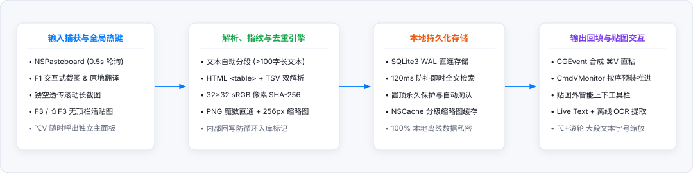
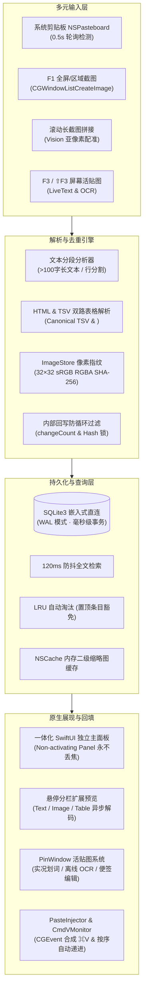

<div align="center">

# MacPaste

### 原生极致轻量的 macOS 剪贴板历史管理器 · 交互式截图标注 · 滚动长截图 · 屏幕活贴图

**零第三方依赖 · 纯 Swift & SwiftUI 原生构建 · 100% 本地离线与极致隐私保护**

[](https://www.apple.com/macos/)
[](https://swift.org)
[](https://support.apple.com/en-us/HT211814)
[-success?style=flat-square)](Package.swift)
[](#存储与性能)
[](LICENSE)

<br />

[快速开始](#-快速开始) · [核心特性](#-核心特性) · [快捷键与操作速查](#-快捷键与操作速查) · [系统架构与工作流](#-系统架构与工作流程) · [编译与打包](#-编译与打包) · [隐私与安全承诺](#-隐私与安全承诺) · [常见问题 (FAQ)](#-常见问题-faq)

<br />

```bash
# 快速编译并安装到 /Applications
git clone https://github.com/HunterLzap/Mac-paste.git && cd Mac-paste && bash Scripts/build.sh
```

<br />


<br />

</div>

> [!IMPORTANT]
> **MacPaste 是一款专为高效键盘与鼠标流打造的专业级生产力工具。**
> 告别庞大笨重的 Electron 剪贴板工具和功能分散的截图贴图软件 —— MacPaste 将 **智能剪贴板历史**、**多段按序粘贴**、**Snipaste 体验的区域标注截图**、**Apple Vision 亚像素级滚动长截图**、以及 **带离线 OCR 的桌面置顶活贴图** 浑然一体地集成在不足 **4 MB** 的纯原生单二进制文件中，常驻内存仅数十兆，开机即用，零延迟响应。

---

## ✨ 核心特性

### 1. 📋 智能剪贴板历史 & 顺序逐段粘贴 (Sequential Paste)
- **多类型智能识别**：自动归类短文本、长文本（>100 字符）、图片及表格；文件路径自动入库并智能过滤重复碎片。
- **革命性「按序粘贴」模式**：对于包含多个自然段或换行清单的文本（如环境配置指令、批量密码、SQL 脚本等），开启后**无需反复切换窗口**，只要在目标软件中直接按 `⌘V`（或快捷键），即可自动按顺序一段段输入，并预装下一段，大幅提升批量录入效率。
- **32×32 sRGB 像素指纹去重**：颠覆传统的字节哈希对比机制，MacPaste 采用解码缩放后的 RGBA 像素指纹做 SHA-256 去重。同一张图片即便在剪贴板中以不同格式（PNG / TIFF）或经不同软件重编码回填，亦能精确识别去重，绝不产生视觉垃圾。
- **表格双表示架构 (TSV + HTML)**：复制 Excel、飞书表格或网页 `<table>` 时，保留结构化矩阵（支持单元格双击复制、Shift 拖选区域复制、列标/行号整行复制）。写回剪贴板时同时输出 Canonical TSV 与标准 HTML，在 Excel 与富文本软件中均可保持行列结构。

### 2. ✂️ 交互式截图 & 亚像素级滚动长截图 (Scroll Capture)
- **Snipaste 级全屏交互体验 (`F1`)**：毫秒级冻结当前屏幕，提供矩形、椭圆、箭头、画笔、荧光笔、像素打码、高保真文字等丰富标注工具，支持 `⌘Z` / `⇧⌘Z` 无损撤销与重做。
- **智能窗口吸附与取色放大镜**：按 `空格键` 自动拾取鼠标所在的上层独立窗口；十字准星伴随局部实时放大镜与 RGB / HEX 拾色器（支持一键复制色值）。
- **Apple Vision 亚像素滚动拼接引擎**：
  - 点击选区工具栏的「滚动截图」按钮，选区四周进入镂空透明状态，**中间区域零窗口遮挡**，鼠标滚轮与触控板事件 100% 直接送达底层网页或应用。
  - 核心采用 `VNTranslationalImageRegistrationRequest` 实时计算垂直位移，辅以**双向真实像素残差 (MAD) 投票**与**动态锚点回滚模型**，即使大幅度来回滚动也绝不产生错位、断层或文字拉花。
  - 支持 `空格键` 触发平滑自动匀速滚屏，亦可手动随心滚轮浏览，右侧实时浮现无遮挡长图预览，按 `Enter` 立即完成并输出高清长图。

### 3. 📌 桌面置顶活贴图 & 原生离线 OCR (`F3` / `⇧F3`)
- **任意内容皆可「贴」在屏幕最前**：按 `F3` 即可将刚截取的图片、复制的长文本、清单或表格直接钉在屏幕最上层；按 `⇧F3` 可一键瞬间隐藏/恢复全部贴图。
- **可直接交互的活贴图 (Interactive Live Pin)**：
  - **图片贴图**：集成 macOS 原生 Live Text（实况文本），直接在贴图图片上划词选中复制；支持滚轮等比缩放、`⌘ + 滚轮` 无级调节窗口透明度（15% ~ 100%）。
  - **离线高精度 OCR**：内置 CoreImage 增强（自适应深色底图反色、2× Lanczos 超分辨率放大与锐化），调用 Apple Vision 框架完全离线识别中英文，自动聚类同行碎片并生成清单。
  - **文本贴图**：支持在「完整排版」、「带序号分段清单（每段独立复制/粘贴/划掉）」与「便签即时编辑」三种模式之间一键切换。
  - **双击胶囊折叠**：双击贴图顶部栏，自动收拢为不占视野的微型胶囊，再双击即恢复。

---

## 🚀 快捷键与操作速查

MacPaste 的快捷键设计深度对齐了行业顶级截图贴图软件的操作直觉：

| 快捷键 / 手势 | 适用场景 | 功能描述 |
| :--- | :--- | :--- |
| <kbd>⌥ Option</kbd> + <kbd>V</kbd> | 全局任意界面 | 唤起 / 置顶 / 前置 MacPaste 历史管理主面板 |
| <kbd>F1</kbd> | 全局任意界面 | 启动交互式区域截图（按 `空格键` 自动拾取窗口） |
| <kbd>F3</kbd> | 全局任意界面 | 将当前剪贴板（刚截的图 / 刚复制的文字 / 表格）贴到屏幕上 |
| <kbd>⇧ Shift</kbd> + <kbd>F3</kbd> | 全局任意界面 | 瞬间隐藏或重新显示屏幕上的所有贴图 |
| <kbd>⌘ Cmd</kbd> + <kbd>V</kbd> | 外部任意文本框 | **开启卡片「按序粘贴」后**，直接连续按 `⌘V` 自动逐段填充并推进 |
| <kbd>⌘ Cmd</kbd> + 滚轮 | 鼠标悬浮在贴图上 | 无级精细调节贴图窗口的透明度（15% ~ 100%） |
| 滚轮 / 触控板滑动 | 处于滚动长截图模式时 | 上下滚动网页或文档，MacPaste 实时自动拼合长图 |
| <kbd>空格键</kbd> | 处于滚动长截图模式时 | 启动 / 暂停自动平滑向下滚动长截图 |
| 双击贴图顶栏 | 屏幕贴图 | 将贴图折叠为超小胶囊态 / 再次双击展开原状 |
| <kbd>Esc</kbd> | 截图 / 贴图 / 预览 | 退出当前截图模式，或关闭当前激活的贴图窗口 |

---

## 🏗️ 系统架构与工作流程

MacPaste 坚持 **零第三方 SPM / CocoaPods / Carthage 依赖**，彻底避免软件供应链风险、内存泄露与兼容性断代：

<br />



<br />



---

## 📊 支持的数据类型与处理机制

| 类别 | 捕获与识别来源 | 存储与去重机制 | 交互与增强功能 |
| :--- | :--- | :--- | :--- |
| **短文本 / 长文本** | 普通复制、终端输出、路径 | 内容 SHA-256 去重；>100 字自动标记为长文本；子段落智能去重 | 悬停即时预览；多段文本提供「按序逐段粘贴」；支持直转便签贴图 |
| **表格 (Table)** | 网页 `<table>`、飞书表格、Excel TSV 复制 | 双路解析；基于 Canonical TSV 跨编码去重；JSON 行列矩阵存储 | 单元格双击快速复制；Shift+点击区域框选；列标/行号整行导出；写回支持 TSV+HTML 双格式 |
| **图片 (Image)** | 截图、浏览器右键复制图片、设计稿 | 32×32 sRGB 像素指纹 SHA-256 去重；PNG 魔数直通免重编码；生成 256px 缓存缩略图 | 右键原生 QuickLook 高清无损缩放预览；一键 F3 转为置顶贴图；支持实况划词与离线 OCR |
| **标注与截屏** | F1 区域截图、空格拾取窗口、滚动长截屏 | 内存无损缓存，导出时自动转换为高质量标准 PNG 并写入剪贴板 | 完整标注工具箱（马赛克、画笔、箭头等）；全屏放大镜实时拾色；亚像素级自动拼合 |

---

## 🛠️ 编译与打包

MacPaste 既支持标准 Xcode/CommandLineTools 的直接编译，也配置了免沙箱问题的快速打包脚本：

### 前置环境
- **操作系统**：macOS 13.0 (Ventura) 或更高版本
- **架构**：Apple Silicon (arm64) / Intel (x86_64)
- **工具链**：Xcode Command Line Tools (`xcode-select --install`)

### 方式一：一键脚本编译与打包（推荐）

项目自带精心优化的 `Scripts/build.sh` 打包脚本，自动处理 SDK 查找、`swiftc` 极速并行优化、App Bundle 目录结构拼装及持久化签名：

```bash
# 赋予执行权限并构建
chmod +x Scripts/build.sh
./Scripts/build.sh
```

构建成功后将生成：
```text
build/
├── bin/MacPaste           # 独立轻量可执行二进制
└── MacPaste.app           # 完整的 macOS 应用程序包
```

直接将 `build/MacPaste.app` 拖入 `/Applications` 文件夹即可使用。

> [!TIP]
> **关于辅助功能权限（TCC）跨重打包持久化**：
> macOS 系统对模拟按键（`⌘V` 自动粘贴）要求授予「辅助功能」权限。若使用临时 ad-hoc 签名，每次重新打包二进制文件后，系统均要求重新勾选授权。
> 如果本地证书管理器中包含名为 `MacPaste Developer` 的自签名证书，`build.sh` 将自动使用该身份进行稳定签名，实现系统授权跨重构永久生效。

### 方式二：使用 Swift Package Manager 调试

```bash
# 禁用沙箱以允许本地模块正常链接
swift build --disable-sandbox -c release
```

---

## 🔒 隐私与安全承诺

我们深知剪贴板数据的极端敏感性（可能涉及个人私钥、工作凭据、聊天记录与财务信息）：

1. **绝对 0 网络通信**：MacPaste 的代码中**没有包含任何网络请求库、数据统计 SDK、Bug 上报探针或第三方组件**，甚至没有向操作系统申请任何网络外联权限。
2. **纯本地离线存储**：历史记录保存在本地用户目录 `~/Library/Application Support/MacPaste/history.db`，由系统级 SQLite3 WAL 保障安全，断电不丢数据。
3. **离线 OCR 与实况文本**：文字识别 100% 由 Apple 芯片的 Neural Engine 与 Vision 框架在本地运行完成，绝不上传到任何远程云端。

---

## ❓ 常见问题 (FAQ)

<details>
<summary><strong>Q: 为什么点击条目粘贴时提示需要辅助功能权限？</strong></summary>

MacPaste 的「点击即粘贴」与「按序逐段粘贴」功能需要通过系统底层的 `CGEvent` 合成 `⌘V` 按键投递给目标应用。macOS 安全机制要求所有模拟键盘事件的应用在「系统设置 → 隐私与安全性 → 辅助功能」中获得授权。授权后即可畅快体验一键回填。
</details>

<details>
<summary><strong>Q: 滚动截图时，有时网页没有反应怎么办？</strong></summary>

滚动截屏模式启动后，选区中间是**完全透明镂空**的，目的是让鼠标事件 100% 穿透到底层应用。请确保在滚动前，鼠标滚轮停留在目标应用的滚动视图区域内；或者直接轻按一次 <kbd>空格键</kbd>，让 MacPaste 为您自动向下平滑平移网页并完成拼合。
</details>

<details>
<summary><strong>Q: 贴图如何快速调整大小与半透明度？</strong></summary>

- **透明度**：将鼠标指针悬停在任意贴图上，按住键盘上的 <kbd>⌘ Cmd</kbd> 键并轻滑鼠标滚轮（或触控板双指滑动），透明度即可在 15% 到 100% 之间丝滑调节；亦可点击顶部的百分比按钮直接选择预设值。
- **缩放**：在贴图上直接滑动滚轮即可等比例缩放；也可拖动右下角边缘手柄任意缩放。
- **折叠**：双击贴图顶栏即可折叠为精巧胶囊，绝不阻挡视线。
</details>

<details>
<summary><strong>Q: 按序粘贴功能是如何工作的？</strong></summary>

当您复制了一段由多行组成的内容（如多行 SQL 语句、连续的测试账号或分步命令），MacPaste 会在卡片上显示「按序粘贴」按钮。点击开启后，MacPaste 会将焦点自动交还给目标应用，并在剪贴板中预置第 1 段；您只需在目标应用中按下系统默认的 <kbd>⌘ Cmd</kbd> + <kbd>V</kbd>，第 1 段粘贴完成后，MacPaste 监听到该按键便会在后台自动将第 2 段预装进剪贴板，您再次按下 <kbd>⌘ Cmd</kbd> + <kbd>V</kbd> 即可贴出下一段，以此类推，直到全部输完。
</details>

---

## 📄 开源许可证

本项目基于 [MIT 许可证](LICENSE) 开源。欢迎提交 Issue 与 Pull Request 共同完善！
