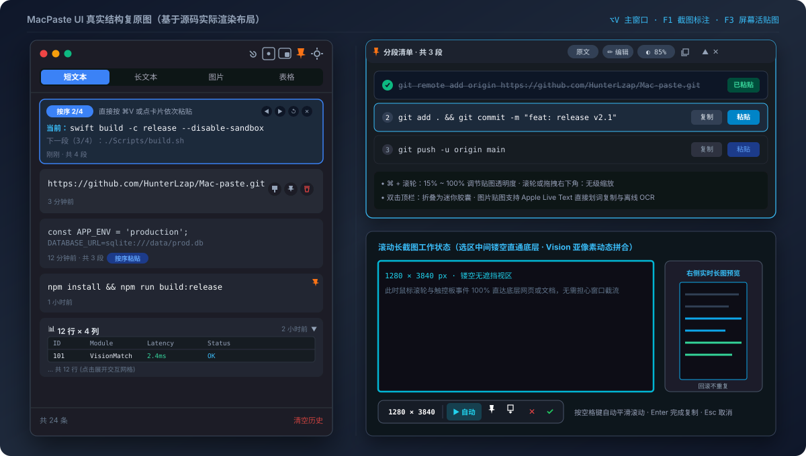

<div align="center">

# MacPaste

### 纯原生 macOS 剪贴板历史管理器 · 交互式截图标注 · 截图原地翻译 · 滚动长截图 · 桌面活贴图

**零第三方依赖 · 纯 Swift & SwiftUI 原生实现 · 100% 本地离线与数据私密**

[](https://www.apple.com/macos/)
[](https://swift.org)
[](https://support.apple.com/en-us/HT211814)
[-success?style=flat-square)](Package.swift)
[](#-本地存储与去重机制)
[](https://github.com/HunterLzap/Mac-paste/releases)
[](LICENSE)

<br />

[快速下载与安装](#-快速下载与安装-推荐) · [核心界面与功能详解](#-核心界面与功能详解) · [快捷键与操作速查](#-快捷键与操作速查) · [本地存储与去重机制](#-本地存储与去重机制) · [编译与打包](#-编译与打包) · [隐私与权限说明](#-隐私与权限说明) · [常见问题 (FAQ)](#-常见问题-faq)

<br />

```bash
# 方式 A：直接前往 Releases 下载开箱即用的预构建应用包
https://github.com/HunterLzap/Mac-paste/releases

# 方式 B：从源码编译并生成 MacPaste.app
git clone https://github.com/HunterLzap/Mac-paste.git && cd Mac-paste && bash Scripts/build.sh
```

<br />



<br />

</div>

> [!NOTE]
> **MacPaste 是一款专注于高频键盘与鼠标交互的原生 macOS 工具。**
> 采用纯 Swift / SwiftUI 编写，零第三方依赖，单二进制可执行文件体积不足 4MB，内存占用仅数十兆。它将**剪贴板历史、多段按序粘贴、带放大镜与标注工具的全屏截图、截图原地替换翻译（24 国语言）、镂空直通的滚动长截图、以及带离线 OCR 的桌面置顶活贴图**深度整合在轻量原生面板中。

---

## 📥 快速下载与安装 (推荐)

如果你不想配置 Xcode 命令行环境，可以直接下载打包好的预构建应用包：

👉 **[前往 GitHub Releases 下载最新版 MacPaste.app (.zip)](https://github.com/HunterLzap/Mac-paste/releases)**

### 安装步骤与 macOS 安全提示解决

1. 下载 `MacPaste-v1.0.0-macOS-arm64.zip` 并双击解压出 `MacPaste.app`。
2. 将 `MacPaste.app` 拖入「访达 - 应用程序」（`/Applications`）中。
3. **首次打开说明（macOS Gatekeeper 安全校验）**：
   - 由于个人独立开源项目未购买 Apple 企业开发者年费证书，macOS 对从浏览器下载的未公证应用会自动打上隔离标记（`apple.quarantine`）。直接双击可能会提示“无法验证开发者”或“已损坏”。
   - **解决方法（任选一种，仅首次需要授权一次）**：
     - **方法一（推荐，纯鼠标操作）**：在访达「应用程序」中找到 `MacPaste.app`，**按住 Control 键点击（或鼠标右键点击）**选择「打开」，在随后弹出的窗口中再次点击「打开」即可永久授权运行。
     - **方法二（终端一键清除隔离标记）**：打开「终端」执行以下命令即可：
       ```bash
       xattr -cr /Applications/MacPaste.app
       ```

---

## 🖥️ 核心界面与功能详解

### 1. 独立主窗口与菜单栏常驻 (`⌥V`)

MacPaste 默认作为菜单栏常驻应用运行（`LSUIElement = true`，无 Dock 图标驻留）：
- **菜单栏图标**：左键单击或双击打开主窗口；右键弹出菜单（包含：区域截图 F1、贴图当前剪贴板 F3、隐藏/显示全部贴图 ⇧F3、关闭全部贴图、设置…、退出 MacPaste）。
- **一体化窗口设计**：标准 macOS 独立窗口（`titled, resizable, nonactivatingPanel`），红绿灯按键悬浮在左侧（预留 62pt 拖动空间），点击条目时不会强夺当前外部应用的激活焦点。
- **单行头部操作栏**：
  - **搜索按钮 (`magnifyingglass`)**：点击后平滑向左滑出搜索胶囊框（最大宽度 170pt），自动聚焦并支持 120ms 防抖检索，按 <kbd>Esc</kbd> 优先收回搜索框。
  - **区域截图按钮 (`camera.viewfinder`)**：立即调出 F1 交互式截图。
  - **贴图按钮 (`pip.enter`)**：立即将当前剪贴板或列表第一条钉在桌面。
  - **窗口置顶按钮 (`pin` / `pin.fill`)**：点亮为橙色高亮，使主窗口保持最前浮动（`level = .floating`）。
  - **设置按钮 (`gearshape`)**：弹出设置 Popover（配置开机启动、点击条目行为、清空是否包含置顶、历史条数上限 100~5000 条）。
- **四项分段分类选择器**：`短文本`、`长文本`（>100 字符）、`图片`、`表格`。
- **底部状态栏**：左侧展示条目总数（`共 N 条`），右侧提供红色 `清空历史` 按钮（带二次确认）。

---

### 2. 连续多段「按序粘贴」模式 (Sequential Paste)

针对包含多个自然段或换行清单的文本（如逐步执行的 Shell 命令、批量账号密码、多段 SQL 脚本），无需在多个软件间频繁按 `⌘-Tab` 切窗：

1. **自动识别**：只要文本包含换行符（过滤空行后 ≥ 2 段），卡片底部会自动出现 `· 共 N 段` 以及蓝色 `按序粘贴` 按钮。
2. **激活按序状态**：
   - 卡片呈现高亮边框与深色背景，头部显示 `按序 当前段/总段数` 蓝色标签，提示“直接按 ⌘V 或点卡片依次粘贴”。
   - 右侧提供 4 个微型圆形控制按钮：上一段（`◀`）、下一段（`▶`）、重置到第 1 段（`↺`）、退出按序模式（`✕`）。
   - 内容区实时展示 `当前：待粘贴内容` 与 `下一段 (M+1/N)：预告内容`。
3. **原生无缝递进**：
   - 开启按序粘贴瞬间，主窗口会自动将键盘焦点归还给先前的外部目标应用，并在剪贴板中预先载入第 1 段。
   - 在目标应用中直接按下键盘 <kbd>⌘ Cmd</kbd> + <kbd>V</kbd>，第 1 段粘贴完成；内置 `CmdVMonitor` 监听到按键后，卡片会有短暂绿色闪烁反馈，并在 100ms 后自动将下一段预装入系统剪贴板。
   - 用户只需连续按下 <kbd>⌘ Cmd</kbd> + <kbd>V</kbd>，即可按顺序逐段填入，直至完成。

---

### 3. 表格双表示解析与交互网格 (Table)

自动捕获网页中的 `<table>...</table>` 标签以及来自 Excel / 飞书表格的 TSV 纯文本：

- **折叠预览**：卡片折叠时展示行列尺寸（如 `12 行 × 4 列`）及前 2 行前 6 列微型预览。
- **点击展开交互式网格**：
  - **单元格双击快速复制**：双击任意单元格即可单独提取内容（带有绿色闪烁反馈）。
  - **单元格单选与区域框选**：单击选中单元格；配合 <kbd>Shift</kbd> + 单击可矩形框选连续区域，工具栏实时显示“已选 R×C”并提供「复制所选区域」。
  - **整行 / 整列提取**：点击顶部列标（A, B, C...）直接复制整列内容；点击左侧行号（1, 2, 3...）直接复制整行内容。
- **TSV + HTML 双格式写回**：复制或粘贴整表时，同时写入规范 Canonical TSV 与标准 HTML 表格，粘贴进 Excel 保持单元格行列，粘贴进富文本软件保持表格排版。

---

### 4. 悬停独立预览面板 (Hover Preview)

在列表条目上悬停鼠标 0.4 秒，即可在主窗口侧边弹出独立的预览面板：

- **鼠标平滑移入**：离开条目提供 0.35 秒宽限期，鼠标可直接移入预览面板进行划词选中文本。
- **多段内容拆分卡片**：若文本含多个段落，预览面板按序号展示每个分段卡片，每个分段右侧均配有独立的「复制」和「粘贴」小按钮。
- **自定义尺寸自由缩放**：预览窗口的底边、右边与右下角均内置拖拽手柄，调整后的尺寸自动持久化保存。

---

### 5. 交互式截图标注、截图原地翻译 & 亚像素滚动长截图 (`F1`)

#### 全屏交互截图
- **8 方向控制点**：支持拖拽 8 个边角/边缘手柄调整截图范围。
- **局部放大镜与取色器**：光标移动时在右上角伴随局部像素放大镜与十字准星，显示精确尺寸、RGB 与 HEX 色值；**按下键盘 <kbd>C</kbd> 键即可直接复制当前光标处的 HEX 颜色代码**。
- **微调快捷键**：使用键盘方向键 <kbd>←</kbd> <kbd>↑</kbd> <kbd>→</kbd> <kbd>↓</kbd> 可按 1 像素精确移动选区；按住 <kbd>Shift</kbd> + 方向键微调选区宽高。
- **完整标注工具箱**：
  - 工具：矩形 (`rectangle`)、圆框 (`circle`)、箭头 (`arrow`)、标记画笔 (`pen`)、荧光笔 (`highlighter`)、打码 (`mosaic`)、文字标注 (`text`)。
  - 样式栏：激活工具时展开 3 级粗细选择（细 2.5 / 中 4.5 / 粗 7.5）以及 8 种调色盘预设颜色。
  - 辅助：支持多次撤销（<kbd>⌘Z</kbd>）、重做（<kbd>⇧⌘Z</kbd>）、一键清空标注。
  - 输出：复制到剪贴板（<kbd>Enter</kbd> / <kbd>⌘C</kbd>）、贴图到桌面（<kbd>F3</kbd>）、保存为 PNG（<kbd>⌘S</kbd>）、提取文字 OCR、进入滚动长截屏、取消（<kbd>Esc</kbd>）。

#### 截图原地智能替换翻译 (支持 24 种常用世界语言)
- **沉浸式原地替换**：告别传统外弹窗式臃肿翻译，翻译结果直接根据原文字排版在原图选区上进行原地替换渲染，智能擦除背景底色，保持原图视觉一致。
- **双段式飞书同款操作**：工具栏悬浮 `[ 翻译图标 | ▾ ]` 分割按钮。点击左侧一键翻译为上次语言；点击右侧 `▾` 呼出画布原生双列 24 国语言选择菜单（支持打勾状态记忆与悬停高亮）。
- **支持 24 种世界主流语言**：
  - 中文 (简体 / 繁體)、English (英语)、日本語 (日语)、한국어 (韩语)
  - Bahasa Indonesia (印尼语)、ไทย (泰语)、Tiếng Việt (越南语)、Bahasa Melayu (马来语)
  - Français (法语)、Español (西班牙语)、Português (葡萄牙语)、Deutsch (德语)、Italiano (意大利语)
  - العربية (阿拉伯语)、فارسی (波斯语)、Türkçe (土耳其语)、Русский (俄语)、Українська (乌克兰语)
  - Polski (波兰语)、Nederlands (荷兰语)、Svenska (瑞典语)、Čeština (捷克语)、हिन्दी (印地语)
- **防卡死与网络超时容错**：内置 4.5 秒硬超时与 3.5 秒网络超时保护，杜绝网络不通时卡在“正在翻译中”；翻译失败或超时自动弹出友好警告重试徽章（点击一键重试，点击选区消除）；翻译过程中可随时再次点击翻译按钮主动取消。
- **全流程无缝联动**：翻译完成后，可一键按 <kbd>F3</kbd> 钉在桌面最前浮动、按 <kbd>⌘S</kbd> 保存为翻译后图片，或按 <kbd>Enter</kbd> / <kbd>⌘C</kbd> 复制到剪贴板。

#### 亚像素滚动长截图 (Scroll Capture)
- **选区中间镂空直通**：四边为青色高亮边框，**选区内部 100% 透明穿透**，鼠标滚轮与触控板事件完全直达底层被截取的网页或软件。
- **双向像素残差 (MAD) 投票与动态锚点**：
  - 基于 Apple `VNTranslationalImageRegistrationRequest` 估算位移。
  - 采用像素重叠残差校验（MAD ≤ 25.0）与动态锚点回滚模型，上下往复滚动时自动退回已有区域，不会产生文字拉花或重复断层。
- **悬浮控制器**：
  - 高度 34pt 的悬浮工具条：显示当前拼合像素尺寸、自动滚动开关按钮（`▶ 自动` / `⏹ 停止`）、贴图 (<kbd>F3</kbd>)、保存、取消 (<kbd>Esc</kbd>)、完成 (<kbd>Enter</kbd>)。
  - 按键盘 <kbd>空格键</kbd> 即可开始/停止自动匀速向下平滑滚屏，亦可按方向键 <kbd>↓</kbd> / <kbd>↑</kbd> 每次步进 36 像素。
  - 右侧浮现 130×190 独立的实时缩略图窗口，直观查看长图实时拼合生长。

---

### 6. 桌面置顶活贴图与离线 OCR (`F3` / `⇧F3`)

按下 <kbd>F3</kbd>，可将刚截取的图片、复制的长文本或表格直接变成悬浮在桌面最顶层的「活贴图」：

- **图片贴图**：
  - **实况文本直接划词**：集成 Apple Live Text，直接在贴图图片上用鼠标拖拽划词复制。
  - **离线 OCR 文字提取**：点击顶栏「提取文字」按钮，内置 CoreImage 预处理（自适应深色底图反色、2× Lanczos 超分辨率放大与锐化）并调用 Apple Vision 离线识别中英文，按行聚类输出清单，每行可单独复制或粘贴。
- **文本贴图三模式切换**：
  - **原文**：保留换行与原始格式，原生可选中文本。
  - **分段清单**：以带序号徽章的清单形式展开，支持点击序号打勾标记已用（带删除线效果），每段配有独立「复制」和「粘贴」按钮。
  - **编辑便签**：点击「编辑」按钮后，贴图切换为文本编辑器，可直接修改内容当做便签使用。
- **贴图手势控制**：
  - <kbd>⌘ Cmd</kbd> + 滚轮：15% ~ 100% 无级调节贴图透明度（亦可点击顶栏百分比弹层滑块选择）。
  - 直接滑动滚轮：纯图片贴图支持直接滑动滚轮进行等比缩放；亦可拖动右下角把手自由调整尺寸。
  - 双击顶栏：折叠收拢为精巧的微型胶囊，再次双击展开原状。
  - 快捷操作：按 <kbd>Esc</kbd> 或 <kbd>⌘W</kbd> 关闭贴图；按 <kbd>Shift</kbd> + <kbd>F3</kbd> 瞬间隐藏或重新显示屏幕上的全部贴图。

---

## ⌨️ 快捷键与操作速查

| 快捷键 / 操作 | 触发场景 | 功能描述 |
| :--- | :--- | :--- |
| <kbd>⌥ Option</kbd> + <kbd>V</kbd> | 全局 | 打开 / 置顶 / 前置主窗口 |
| <kbd>F1</kbd> | 全局 | 启动交互式全屏截图标注 |
| <kbd>F3</kbd> | 全局 | 将当前剪贴板内容作为置顶活贴图贴到屏幕上 |
| <kbd>⇧ Shift</kbd> + <kbd>F3</kbd> | 全局 | 一键隐藏 / 重新显示全部桌面贴图 |
| <kbd>⌘ Cmd</kbd> + <kbd>V</kbd> | 外部文本框 | **开启卡片「按序粘贴」后**，直接连续按 `⌘V` 自动逐段填充并推进 |
| 点击工具条 `[ 翻译 ]` | F1 截图进行中 | 原地替换翻译所选文字（自动采样底色、对齐排版） |
| 点击工具条 `[ ▾ ]` | F1 截图进行中 | 展开原生双列 24 种语言选择下拉菜单（支持实时切换与记忆） |
| <kbd>C</kbd> | F1 截图进行中 | 复制当前十字准星光标所在位置的十六进制颜色代码 (HEX) |
| 方向键 <kbd>←</kbd> <kbd>↑</kbd> <kbd>→</kbd> <kbd>↓</kbd> | F1 截图进行中 | 1 像素精确微调当前选区位置（配合 <kbd>Shift</kbd> 调整选区尺寸） |
| <kbd>空格键</kbd> | 滚动截图进行中 | 启动 / 暂停自动平滑向下滚动截图 |
| 方向键 <kbd>↓</kbd> / <kbd>↑</kbd> | 滚动截图进行中 | 单步向下 / 向上平移 36 像素并拼合 |
| <kbd>⌘ Cmd</kbd> + 滚轮 | 鼠标悬浮在贴图上 | 无级精细调节贴图窗口的透明度（15% ~ 100%） |
| 滚轮滑动 | 纯图片贴图上 | 等比例放大或缩小贴图尺寸 |
| 双击顶栏 | 屏幕活贴图 | 折叠为微型胶囊 / 再次双击恢复展开 |
| <kbd>Esc</kbd> | 截图 / 贴图 / 搜索 | 退出当前截图；关闭当前贴图；优先收起主窗口搜索框 |
| <kbd>Enter</kbd> | 截图 / 滚动长截图 | 完成当前选区截取或拼合，并将结果写入系统剪贴板 |

---

## 💾 本地存储与去重机制

- **SQLite3 WAL 存储**：历史数据库存储在 `~/Library/Application Support/MacPaste/history.db`，开启 WAL 模式与索引优化，查询检索响应时间 < 2ms。
- **32×32 sRGB 像素指纹去重**：
  - 复制图片时，MacPaste 对图像进行解码并统一缩放为 32×32 像素、铺设纯白底色、转为标准 sRGB 颜色空间的 RGBA 像素矩阵，对其字节计算 SHA-256。
  - 无论同一张图片以 PNG 还是 TIFF 形式进出剪贴板，或是经过重编码回填，像素指纹保持一致，从根本上解决图片重复入库问题。
- **PNG 魔数直通**：捕获系统截屏时检测 PNG 文件头特征（`89 50 4E 47...`），剪贴板原始为 PNG 数据时跳过整图二次重编码，大幅降低截图落盘开销。
- **自动淘汰与置顶保护**：超出历史记录上限（默认 500 条）时，系统自动淘汰最旧的记录并联动清理对应图片磁盘文件；带有图钉标记的置顶条目享有永久保护。

---

## 🔨 编译与打包

### 系统要求
- macOS 13.0 (Ventura) 及以上版本
- Apple Silicon (arm64) 或 Intel 架构
- 已安装 Xcode Command Line Tools（终端执行 `xcode-select --install`）

### 推荐构建方式：一键脚本打包

项目内置优化好的构建脚本 [Scripts/build.sh](file:///Users/ryan/Documents/tools/Mac-paste/Scripts/build.sh)，使用 `swiftc` 直接编译组装应用包：

```bash
chmod +x Scripts/build.sh
./Scripts/build.sh
```

脚本执行完成后，将在 `build/` 目录下生成：
- `build/bin/MacPaste`：独立编译二进制
- `build/MacPaste.app`：完整的 macOS 应用程序包

将 `MacPaste.app` 移入 `/Applications` 文件夹即可直接运行，并在设置中开启「开机自动启动」。

> [!TIP]
> **关于辅助功能权限（TCC）跨重打包持久化**：
> macOS 系统在模拟合成键盘事件（`⌘V` 自动粘贴）时，要求授予「辅助功能」权限。如果使用系统临时的 ad-hoc 签名，每次重新打包二进制，系统因识别到签名哈希改变都会要求重新授权。
> 如果本地钥匙串中导入了名为 `MacPaste Developer` 的自签名代码签名证书，`build.sh` 将自动使用该身份进行签名，辅助功能授权将永久跨版本持久生效。

---

## 🔐 隐私与权限说明

1. **核心数据 100% 本地离线**：剪贴板历史记录、SQLite3 数据库、32×32 像素指纹去重、以及基于 Apple 原生 Vision / VisionKit 的实况文本与离线 OCR 提取均在芯片本地执行，绝不向远程服务器发送图像与剪贴板数据，无任何行为追踪探针。
2. **截图按需翻译**：仅在用户主动点击截图悬浮工具栏中的「翻译」按钮时，按需调用轻量翻译端点，不收集或留存任何个人隐私与截图原图。
3. **权限按需申请**：
   - **屏幕录制权限 (Screen Recording)**：用于全屏截图、取色器与滚动截屏捕获屏幕图像（首次截图时由系统弹窗申请）。
   - **辅助功能权限 (Accessibility)**：仅在开启「点击条目即粘贴」或使用「按序粘贴」合成按键时需要（若仅作为剪贴板查看器或复制使用，无需该权限）。

---

## ❓ 常见问题 (FAQ)

<details>
<summary><strong>Q: 首次从 GitHub Releases 下载打开提示“无法验证开发者”或“已损坏”怎么办？</strong></summary>

这是 macOS 系统针对未购买每年 $99 苹果企业年费证书的独立开源软件施加的默认 Gatekeeper 安全机制（对下载文件标记 `com.apple.quarantine` 隔离属性）。
- **解决方法一（最简便，鼠标操作）**：在「访达 - 应用程序」中找到 `MacPaste.app`，**按住键盘 Control 键并单击（或右键）**，选择「打开」，在弹出确认框中点击「打开」即可永久授权。
- **解决方法二（终端一键解决）**：打开「终端」执行 `xattr -cr /Applications/MacPaste.app` 即可立即双击正常使用。
</details>

<details>
<summary><strong>Q: 为什么点击条目粘贴时提示辅助功能未授权？</strong></summary>

模拟按键将内容自动粘贴到外部软件中需要系统底层的 `CGEvent` 注入事件支持。请在「系统设置 → 隐私与安全性 → 辅助功能」中找到 MacPaste 并勾选允许。若暂不需要自动粘贴，可在设置中将「点击条目时」改为「复制」。
</details>

<details>
<summary><strong>Q: 滚动截图时底层页面没有随滚轮滑动怎么办？</strong></summary>

启动滚动截图后，选区内部已处理为完全透明镂空，滚轮事件直接发往底层。请确保鼠标指针停留在目标软件的可滚动页面区域内；或者直接轻按一次 <kbd>空格键</kbd>，MacPaste 将自动平滑向下滚动页面并完成拼合。
</details>

<details>
<summary><strong>Q: 贴图怎么快速调透明度和折叠？</strong></summary>

- **透明度调节**：按住键盘 <kbd>⌘ Cmd</kbd> 键并在贴图上滑动鼠标滚轮，透明度可在 15% 到 100% 之间无级变化。
- **折叠与展开**：双击贴图顶栏空白区域即可折叠为小胶囊，再次双击恢复。
- **尺寸缩放**：在纯图片贴图上直接滑滚轮等比缩放，或拖动右下角把手任意缩放。
</details>

<details>
<summary><strong>Q: 复制了单段内容，为什么列表中没有单独出现？</strong></summary>

为了保持历史记录干净，MacPaste 内置了子段落去重机制：如果复制的一行文本已经完整包含在最近的多段文本记录中，系统不会额外生成冗余单行碎片条目。
</details>

---

## 📄 开源许可证

本项目基于 [MIT 许可证](LICENSE) 开源。
